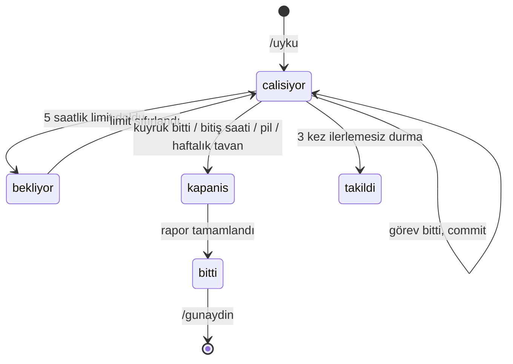

# claude-skills-tr

**Claude Code için Türkçe iş akışı skill'leri.** Her gün yazdığın uzun prompt'ları tek komuta çevirir: patronun PDF'ini koda dönüştürür, sen uyurken güvenli sınırlar içinde çalışmaya devam eder, uzayan session'ı temiz bir session'a devreder.


> *English summary at the bottom.*

---

## Bir bakışta

| Komut | Ne yapar |
|---|---|
| [`/analiz`](#analiz--istek-dokümanını-koda-dönüştür) | PDF'i, toplantı notunu ya da istek metnini maddelere ayırır, kodla karşılaştırır; olmayanları kodlar, olanları dokümana göre günceller. |
| [`/uyku`](#uyku--sen-uyurken-çalışsın) | Gece modu. Kritik kararları sabaha bırakıp geri kalan işi pil, kullanım limiti ve bitiş saatine göre sürdürür. |
| [`/gunaydin`](#gunaydin--sabah-incelemesi) | Gece raporunu özetler, kritik kararları seçenekli sorar, onaylananları uygular. |
| [`/devir`](#devir-ve-devam--uzayan-sessionı-devret) | Uzayan session'ın "nerede kaldık" notunu yazar. |
| [`/devam`](#devir-ve-devam--uzayan-sessionı-devret) | Yeni session'da o notu okuyup kaldığı yerden sürer. |
| [`/kontrol`](#kontrol--push-öncesi) | Push öncesi testler, lint, tip kontrolü + sızmış secret, debug log'u, çakışma işareti taraması. |
| [`/rapor`](#rapor--patrona-durum-raporu) | Patrona/yöneticiye teknik olmayan durum raporu. |
| [`/haftalik`](#haftalik--haftalık-özet) | Bütün projelerindeki haftalık commit'lerden tek özet. |
| [`/mobil-tur`](#mobil-tur--simülatörde-görsel-tur) | Uygulamayı simülatörde gezer, bozuk ekranları raporlar. |

## Hızlı başlangıç

```bash
git clone https://github.com/mehmethayirli/claude-skills-tr.git
cd claude-skills-tr
./kur.sh
```

`kur.sh` skill'leri `~/.claude/skills/` altına **symlink** ile bağlar; repoyu güncellediğinde (`git pull`) skill'ler de güncellenir. Aynı adda bir skill'in varsa silmez, yedekler. Kopyalamayı tercih edersen `./kur.sh --kopyala`, kaldırmak için `./kur.sh --kaldir`.

Yeni bir Claude Code session'ı aç ve `/` yaz — skill'ler listede. Açık bir session'daysan önce `/reload-skills`.

## Tipik günler

**Patron PDF attı:**
```
/analiz            ← PDF'i mesaja sürükle
/kontrol
/rapor             ← patrona gönderilecek özet
```

**Akşam, iş bitmedi:**
```
/uyku testleri tamamla, ödeme ekranındaki hataları düzelt
                   ← yat. Kapağı açık bırak.
/gunaydin          ← sabah: rapor + kritik kararlar
```

**Session 400k token'a ulaştı:**
```
/devir             ← not yazılır, yeni session teklif edilir
/devam             ← yeni session'da, temiz context'le
```

---

## `/analiz` — istek dokümanını koda dönüştür

```
/analiz                          ← PDF'i ya da metni aynı mesaja ekle
/analiz ~/Downloads/brief.pdf
/analiz ~/Downloads/brief.pdf --onaysiz
```

1. **Okur.** PDF'i önce `pdftotext` ile metne çevirir (görsel okumaya göre çok daha az token). Taranmış PDF'lerde görsele düşer.
2. **Maddelere ayırır:** `R1, R2, …` — her biri test edilebilir, kaynağa referanslı. Toplantı notlarındaki "belki", "ileride" gibi ifadeleri gereksinim saymaz.
3. **Kodla karşılaştırır:** her madde için **Var / Kısmen / Yok / Çelişiyor** + kanıt (`dosya:satır`). Çok maddeli işlerde taramayı daha ucuz bir modelle çalışan bir subagent'a verir.
4. **Sadece riskli maddeleri sorar:** mevcut davranışı değiştiren (çelişen) ve iki şekilde yorumlanabilen maddeler. Gerisini onay beklemeden kodlar. `--onaysiz` ile hiç sormaz: çelişen maddelerde doküman kazanır, muğlak maddeler "patrona sorulacaklar" listesine gider.
5. **Uygular:** ayrı bir dalda (`istek/<ad>`), madde başına commit (`feat(R3,R4): …`), test ekleyerek.
6. **İz bırakır:** `docs/istekler/<tarih>-<ad>.md` — madde tablosu, sonuçlar, patrona gönderilebilecek soru listesi. `/rapor` ilerlemeyi buradan okur.

## `/uyku` — sen uyurken çalışsın

```
/uyku
/uyku testleri tamamla ve sepet hatasını düzelt bitis=07:30
/uyku pil=40 limit=70 haftalik=50
```

| Ayar | Varsayılan | Anlamı |
|---|---|---|
| `bitis` | `08:00` | Bu saatte raporu tamamlayıp durur. |
| `pil` | `27` | **Pildeyken** şarj bu yüzdeye düşünce durur. Prizdeyken uygulanmaz. |
| `limit` | `80` | 5 saatlik kullanım bu yüzdeye gelince **durmaz, bekler**; limit sıfırlanınca devam eder. |
| `haftalik` | `60` | Haftalık kullanım bu yüzdeyi geçerse durur. |

**İş kuyruğu** şu sırayla toplanır: komuttaki görevler → konuşmada yarım kalan işler → son `/devir` notunun sıradaki adımları → son `/analiz` dokümanındaki bitmemiş maddeler.

**Kurallar:**
- **Kritik kararları vermez:** geri dönüşü zor ya da proje dışına dokunan işler, şema/veri değişikliği, yeni ücretli bağımlılık, public API değişikliği, mimari tercih, iki makul yorumu olan gereksinim. Bunları seçenekleri ve önerisiyle rapora yazar, etrafından dolaşıp bağımsız işlere devam eder.
- **Küçük kararları verir** (isimlendirme, iç yapı, test, refactor) ve gerekçesini rapora yazar.
- **Her görev ayrı commit** — sabah tek tek geri alınabilir. Çalışmayan kod commit edilmez.
- **Ana context'i küçük tutar:** büyük görevleri sırayla subagent'lara verir, sadece özetlerini alır.

### Neden gerçekten sabaha kadar sürüyor?

Gece işinde asıl risk limitler değil, Claude'un 01:00'de "bitti" deyip durması ya da bir izin penceresinde sabaha kadar beklemesidir. `/uyku` bunu skill'in kendi **hook**'larıyla çözer. Hook'lar yalnızca `/uyku`'yu çağırdığın session'da devreye girer, diğer session'lara dokunmaz.

| Hook | Görevi |
|---|---|
| **Stop** | Uyku modu açıkken turun erken bitmesine izin vermez, Claude'u sıradaki göreve yönlendirir. Bitiş saati ya da pil eşiğinde önce "raporu tamamla" der, sonra durdurur. İlerleme olmadan 3 kez durmaya çalışırsa takıldı sayar ve bırakır — boşa token yakan döngü olmaz. |
| **PreToolUse** | `git push`, `merge`, `rebase`, `reset --hard`, `clean -f`, PR açma, deploy, publish, gerçek veritabanına migration ve dışarıya mesaj/e-posta gönderen MCP araçlarını engeller. Claude engeli kritik karar olarak rapora yazar. |
| **StopFailure** | Tur bir API hatasıyla biterse (aşırı yük, sunucu hatası, rate limit) bekleyip Claude'u yeniden uyandırır; gece boyunca en fazla 5 kez. Kalıcı hatalarda (kimlik doğrulama, fatura) durur. |



**Gece için iki şart:**
1. Session **auto mode**'da olmalı. Değilse `/uyku` başlamadan uyarır (ilk izin isteğinde sabaha kadar takılır).
2. **Kapağı açık bırak.** Mac'in boşta uyuması engellenir, ama kapak kapanınca macOS her durumda uyur.

## `/gunaydin` — sabah incelemesi

Uyku modunu kapatır (hook'lar devre dışı kalır), gece raporunu ~15 satırda özetler, kritik kararları seçenekli butonlarla sorar (önerilen seçenek ilk sırada) ve onayladıklarını ayrı commit'lerle uygular.

Örnek gece raporu bölümü:

```markdown
## Kritik kararlar (onayın gerekiyor)
### K1. Sepet tablosuna `indirim_kodu` sütunu
- Bağlam: R7 indirim kodu istiyor; şema değişikliği gerekiyor.
- Seçenekler: A) sepet tablosuna sütun  B) ayrı `indirimler` tablosu
- Önerim: B — birden fazla kod desteği isteniyor (PDF s.4).
- Bekleyen iş: indirim API'si ve ekranı
```

## `/devir` ve `/devam` — uzayan session'ı devret

Uzun bir session'a devam etmek pahalıdır: her mesajda bütün konuşma yeniden işlenir. `/devir` 2-3k token'lık bir not yazar; yeni session `/devam` ile bu notla başlar.

Not şunları içerir: amaç, yapılanlar, **şu an nerede kalındı**, sıradaki adımlar, **alınan kararlar** (yeniden tartışılmasın), **denenip işe yaramayanlar** (tekrar denenmesin), açık sorular, önemli dosyalar, çalıştırma komutları.

- Commit edilmemiş değişiklik varsa ve özellik dalındaysan `wip:` commit'i atar — yeni session başka bir worktree'de açılsa da iş kaybolmaz.
- Claude Code masaüstü uygulamasında yeni session'ı senin için açmayı teklif eder (aynı klasör, ilk mesaj `/devam`).
- `/devam` dal uyuşmazlığını ve nottan sonraki commit'leri kontrol eder, 4-6 satır özet verir ve ilk adımdan hemen başlar.

## `/kontrol` — push öncesi

```
/kontrol
/kontrol --tam          ← build ve yavaş kontroller dahil
```

Projenin kendi test/lint/tip kontrolü komutlarını bulur (CLAUDE.md → README → `package.json` / `pyproject` / `go.mod` / `Cargo.toml`) ve çalıştırır; geçenler için sadece ✅ yazar, çıktıyı context'e dökmez. Ardından taban dala göre **eklenen satırları** tarar:

- sızmış secret (Anthropic, OpenAI, AWS, GitHub, Slack, Google anahtarları, private key, `password = "..."`)
- debug kalıntısı (`console.log`, `debugger`, `binding.pry`, `pdb.set_trace` …)
- çakışma işaretleri, yeni TODO/FIXME, `.env` dosyası, 1 MB üstü dosyalar

Push etmez; mekanik düzeltmeler için tek soru sorar.

## `/rapor` — patrona durum raporu

```
/rapor
/rapor son 14 gün
/rapor --teknik
```

Son rapordan bu yana git geçmişini, `/analiz` dokümanlarındaki ilerlemeyi ve bekleyen kararları toplar; **teknik terimsiz**, iş değeriyle yazar ("Müşteriler artık …"). İstek dokümanı varsa: *"12 maddeden 9'u tamamlandı, 2'si sizin cevabınızı bekliyor."* Uydurmaz, kimseye göndermez.

## `/haftalik` — haftalık özet

```
/haftalik
/haftalik 14 --patron
/haftalik 7 ~/Projeler
```

`~/Documents/GitHub` altındaki bütün repolarda senin commit'lerini toplar (worktree'ler tek proje sayılır), proje başına 2-4 maddelik özet çıkarır.

## `/mobil-tur` — simülatörde görsel tur

```
/mobil-tur
/mobil-tur giriş, sepet, ödeme --karanlik
```

iOS (native, Expo/React Native, Flutter) ve Android'de uygulamayı derleyip ana ekranları gezer; taşan metin, safe area çakışması, takılı yükleme ekranı, klavyenin kapattığı alanlar gibi sorunları tablo halinde raporlar. Token için ekran görüntülerini yarım çözünürlükte alır, şüpheli yerleri yakınlaştırır. Düzeltmeyi sonda sorar.

---

## Notlar nerede durur?

| Ne | Nerede |
|---|---|
| Devir notları, gece raporları, patron raporları, mobil tur görüntüleri | `~/.local/state/claude-notlar/<proje>-<hash>/` |
| Uyku modu durumu | `~/.local/state/claude-uyku/<session-id>/` |
| `/analiz` dokümanları | Repoda: `docs/istekler/` |

Notlar repo dışında durur — commit'lere karışmaz. Anahtar ana reponun yolu olduğu için **aynı reponun bütün worktree'leri aynı notları görür**.

## Token tasarrufu

- Kullanılmayan skill'in maliyeti yalnızca açıklama satırıdır; `/uyku`, `/gunaydin`, `/mobil-tur` sadece sen çağırınca yüklenir, açıklamaları bile context'e girmez.
- PDF'ler metne çevrilir, diff'ler okunmaz (commit mesajları ve `--stat` yeterli), test çıktıları `tail` ile kısaltılır.
- Uzun işler subagent'lara bölünür; ana context küçük kalır.
- `/devir` + `/devam` uzun session'ları sıfırlamanın en ucuz yolu.

## Gereksinimler ve sınırlamalar

- **macOS.** `/uyku` `pmset`, `caffeinate` ve BSD `date` kullanır. Diğer skill'ler Linux'ta da büyük ölçüde çalışır ama test edilmedi.
- `jq` (macOS 15+ ile gelir; yoksa `brew install jq`), `git`, `python3`
- İsteğe bağlı: `pdftotext` (`brew install poppler`) — yoksa `/analiz` PDF'leri görsel okur.
- **Claude Code masaüstü uygulaması önerilir.** `/uyku`'nun kullanım yüzdesi kuralları uygulamanın kullanım aracına, `/devir`'in yeni session açması uygulamanın session aracına dayanır. Terminalde de çalışır; o zaman yüzde kuralları uygulanmaz (pil, bitiş saati ve kuyruk kuralları yine geçerli).
- Skill frontmatter hook'ları gerektirir (güncel Claude Code sürümleri).

## Testler

```bash
./tests/calistir.sh
```

95 kontrol: script sözdizimi, frontmatter, uyku durum makinesi (pil/priz, bitiş saati, bekleme, subagent, takılma), koruma kuralları (30 komut/araç), API hatası sonrası uyandırma, worktree'ler arası not dizini, secret/debug taraması. Geçici bir `HOME` kullanır; gerçek dosyalarına dokunmaz.

## Proje yapısı

```
skills/
├── analiz/SKILL.md
├── devir/SKILL.md
├── devam/SKILL.md
├── uyku/
│   ├── SKILL.md              ← hook tanımları frontmatter'da
│   └── scripts/
│       ├── uyku.sh           ← durum yönetimi (Claude bunu çağırır)
│       ├── uyku-stop.sh      ← Stop hook
│       ├── uyku-koruma.sh    ← PreToolUse hook
│       └── uyku-hata.sh      ← StopFailure hook
├── gunaydin/SKILL.md
├── kontrol/{SKILL.md, scripts/tara.sh}
├── rapor/SKILL.md
├── haftalik/{SKILL.md, scripts/topla.sh}
├── mobil-tur/SKILL.md
└── ortak/scripts/notlar-dizini.sh
kur.sh
tests/calistir.sh
```

## Özelleştirme

Skill'ler düz Markdown'dır; `skills/<ad>/SKILL.md` dosyasını düzenle, kaydet — symlink ile kurduysan Claude Code değişikliği hemen görür. Varsayılan eşikleri (`bitis`, `pil`, `limit`, `haftalik`) `skills/uyku/SKILL.md` içinde değiştirebilirsin. Koruma kurallarına desen eklemek için `skills/uyku/scripts/uyku-koruma.sh` → `desenler`; eklediğin kural için `tests/calistir.sh`'a bir satır eklemeyi unutma.

## Katkı

Issue ve PR'lar açık. Göndermeden önce `./tests/calistir.sh` çalıştır. Skill metinleri Türkçe; yeni skill eklerken aynı üslubu (kısa, emir kipinde, token'a duyarlı) korumaya çalış.

## Lisans

[MIT](LICENSE)

---

## English summary

**claude-skills-tr** is a set of Turkish-language [Claude Code](https://code.claude.com) skills for everyday development work:

- **`/analiz`** — turns a requirements PDF or meeting notes into a requirement-by-requirement gap analysis (exists / partial / missing / conflicting) and implements it on a branch, asking only about conflicting or ambiguous items.
- **`/uyku`** ("sleep") — an overnight mode that keeps working through a task queue while you sleep. Skill-scoped hooks prevent premature stops, block irreversible actions (push, merge, deploy, publish, outbound messages), pause until the 5-hour usage window resets, stop at a battery threshold (on battery only), a deadline or a weekly usage cap, and recover from transient API errors. Critical decisions are deferred to a morning report.
- **`/gunaydin`** ("good morning") — summarizes the night report and walks you through deferred decisions.
- **`/devir` / `/devam`** ("hand off" / "continue") — write a compact handoff note and resume from it in a fresh session, instead of dragging a huge context along.
- **`/kontrol`**, **`/rapor`**, **`/haftalik`**, **`/mobil-tur`** — pre-push checks with secret scanning, non-technical status reports for managers, weekly summaries across all repos, and a visual QA pass in the iOS/Android simulator.

Install with `./kur.sh` (symlinks into `~/.claude/skills`). Requires macOS, `jq`, `git` and `python3`; best used in the Claude Code desktop app.
